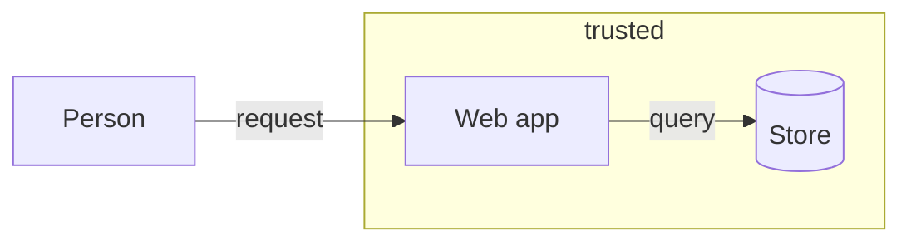

# Threat model

Threats come from the structure of the design, so coverage can be checked. You work from the design you were given; if it is too thin to draw, say what is missing.

## 1. Draw the data flow

Write a text diagram of the external actors, processes, data stores and data flows, and mark each trust boundary: where data passes between parts with different owners or privileges.

Every flow that crosses a boundary is a crossing. List them.

## 2. Go through STRIDE at each crossing

| Letter | Threat | Asks |
|---|---|---|
| S | Spoofing | can a caller pretend to be someone else |
| T | Tampering | can data be changed in flight or at rest |
| R | Repudiation | can an action be denied with no record |
| I | Information disclosure | can data reach someone who must not see it |
| D | Denial of service | can it be made unavailable |
| E | Elevation of privilege | can a caller do more than allowed |

Name only the threats that apply, each with its fix. A letter that does not apply gets no row.

## 3. Record each one

Write a risk atom per threat; a read-only reviewer reports each in the same shape for its owner to write. Set `category` to the STRIDE letter as stride-s and so on, `threatens` to the crossing's interface or boundary id, and `mitigated-by` to the rule or decision that fixes it. Give likelihood and impact as low, med or high only against a scale the project has defined; otherwise leave them empty and ask.

## 4. Check coverage

Every crossing has at least one risk, or a written waiver on its interface with the reason. The `boundary-covered` check reads this.

Never report a threat you cannot tie to a crossing in the design. Mark every assumption as an assumption.
